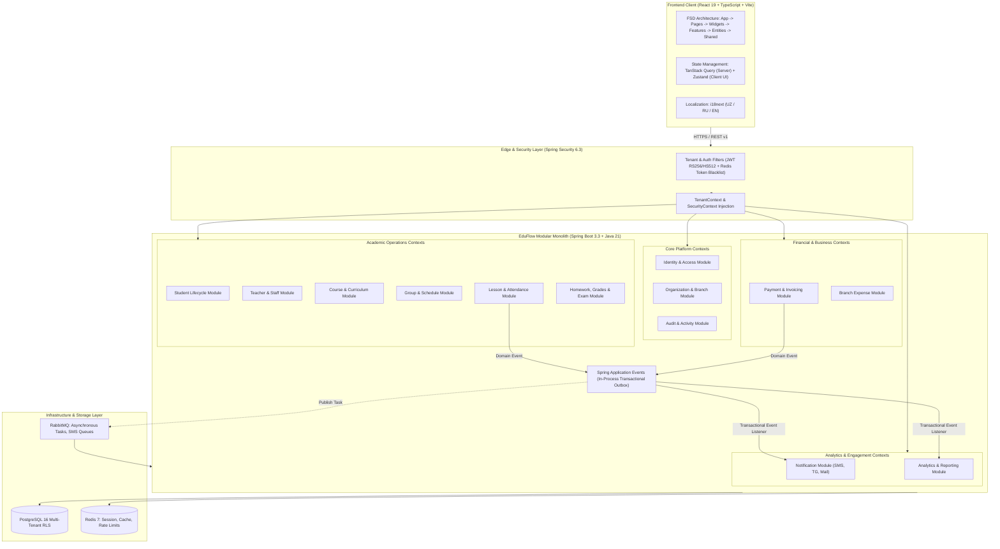
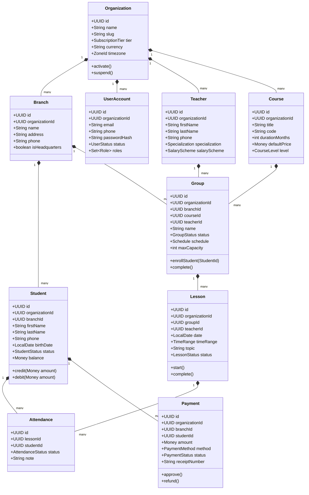
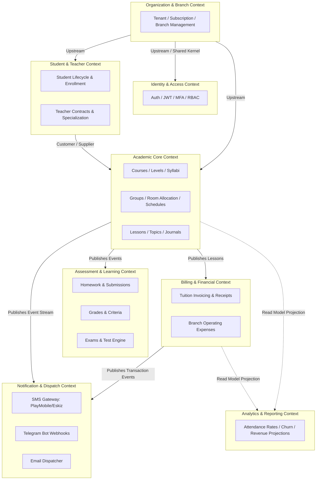
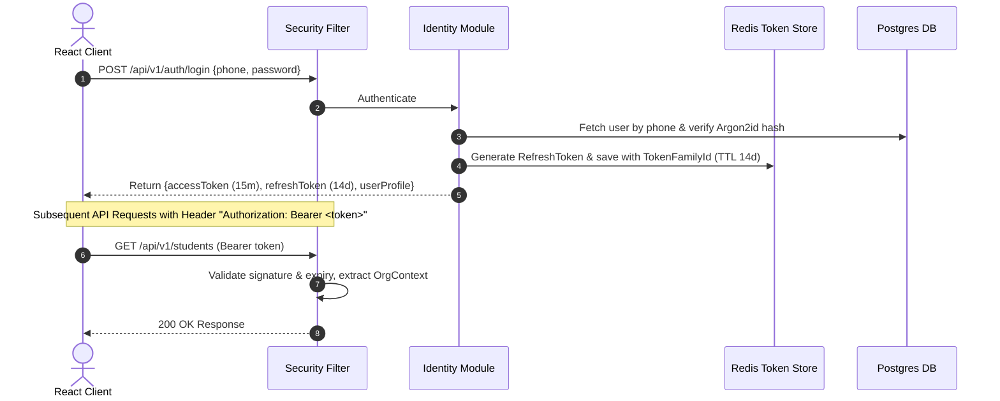
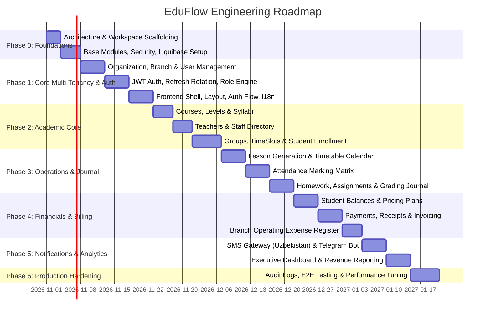

# EduFlow: SaaS Platform Architecture Blueprint & Technical Specification

> **System**: EduFlow — Multi-Tenant Education Center Management SaaS  
> **Target Audience**: Commercial Education Centers, Language Academies, Prep Schools, Vocational Academies  
> **Architecture Paradigm**: Modular Monolith with Clean Architecture & Domain-Driven Design (DDD)  
> **Status**: Approved Architectural Baseline (Phase 0)

---

## 1. Product Architecture

### 1.1 Architectural Topology: Modular Monolith
EduFlow is architected as a high-performance **Modular Monolith** running on **Java 21** and **Spring Boot 3.3+**. It offers the team productivity and transactional simplicity of a single deployable unit while enforcing the strict physical and logical boundaries of microservices.



### 1.2 Module Layering & Clean Architecture
Each module in EduFlow strictly adheres to Clean Architecture layers with strict dependency inversion:

```
module-root (e.g., group/)
├── domain/                  # PURE JAVA: Aggregates, Entities, Value Objects, Domain Events, Domain Exceptions
│   ├── model/               # Group, GroupSchedule, GroupEnrollment, StudentLimit
│   ├── event/               # GroupActivatedEvent, GroupCompletedEvent
│   ├── exception/           # GroupCapacityExceededException, ScheduleConflictException
│   └── repository/          # GroupRepository (Interface ONLY, no Spring Data JPA)
├── application/             # APPLICATION LOGIC: Use cases, CQRS Command/Query Handlers, DTOs, Outbound Ports
│   ├── usecase/             # CreateGroupUseCase, EnrollStudentUseCase
│   ├── dto/                 # CreateGroupCommand, GroupDetailResponse, GroupSearchCriteria
│   └── port/                # Outbound SPIs (e.g., CourseQueryPort, BranchQueryPort)
├── infrastructure/          # ADAPTERS: Persistence, Spring Data JPA, External APIs, Mappers
│   ├── persistence/         # GroupJpaEntity, SpringDataGroupRepository, GroupRepositoryImpl
│   ├── mapper/              # GroupMapStructMapper
│   └── config/              # Module-specific Spring bean configuration
└── presentation/            # DELIVERY: REST Controllers, OpenAPI Annotations, Request Validators
    ├── controller/          # GroupController, GroupEnrollmentController
    ├── request/             # CreateGroupRequest, UpdateScheduleRequest
    └── response/            # GroupSummaryResponse, GroupScheduleResponse
```

### 1.3 Communication Rules Across Modules
1. **Zero Direct Entity Access**: Module `A` must NEVER inject JPA entities or repositories from Module `B`.
2. **Synchronous In-Process API**: If Module `A` needs data or operations from Module `B`, it calls a declared public interface (`*ModuleApi` or `*QueryPort`) exposed in `B`'s application layer.
3. **Asynchronous Decoupling**: Cross-module state transitions (e.g., `PaymentSucceeded` -> `UpdateStudentBalance` -> `SendReceiptSMS`) communicate through domain events using Spring's `@ApplicationModuleListener` / `TransactionalEventListener` and RabbitMQ.
4. **Architectural Guardrails**: Enforced via **ArchUnit** tests in CI to ensure that domain layers never import presentation or infrastructure packages, and cross-module boundaries are inviolate.

---

## 2. Domain Model & Invariants



### 2.1 Domain Invariants & Business Rules
- **Tenant Isolation**: Every aggregate root must carry an immutable `organizationId`. Any state transition must verify that target child entities belong to the same tenant.
- **Group Capacity**: A group cannot exceed its configured `maxCapacity` without an explicit managerial override privilege (`group:override_capacity`).
- **Schedule Clashing**: A teacher or room cannot be booked for overlapping time windows within the same branch.
- **Attendance Locking**: Completed lessons lock attendance records from modification after 48 hours unless unlocked by a Branch Manager or Owner.
- **Financial Auditability**: Payments are immutable records. Once completed, they cannot be updated or deleted; corrections require explicit `Refund` or `CreditAdjustment` transactions.
- **Student Balance Invariant**: A student's billing balance is an event-sourced or ledger-backed projection calculated from approved payments, discounts, and lesson/group tuition charges.

---

## 3. Bounded Contexts & Context Mapping



### 3.1 Upstream/Downstream Relationships
- **Customer/Supplier (People -> Academic)**: Group scheduling depends on active Student and Teacher profiles.
- **Published Language / Domain Events (Academic -> Billing)**: Attendance marking or enrollment completion triggers billing events processed by the Billing module asynchronously.
- **Anti-Corruption Layer (ACL) for External Gateways**: The Notification module encapsulates vendor-specific SMS APIs (e.g. Eskiz.uz, PlayMobile) behind a clean `SmsNotificationPort`.

---

## 4. Database ERD Concept & Multi-Tenancy Strategy

### 4.1 Multi-Tenancy Model: Partitioned Row-Level Isolation
- **Approach**: Shared Database, Shared Schema with strict Row-Level Security (RLS) and Application-Level Filters (`@TenantId` / Hibernate Filters).
- **Primary Keys**: **UUIDv7** across all tables (time-ordered, index-friendly, secure against enumeration attacks).
- **Tenant Key**: `organization_id UUID NOT NULL` indexed on all tenant-scoped tables.
- **Branch Scope**: `branch_id UUID NULL` on branch-specific records (allows multi-branch or org-wide entities).

### 4.2 Standard Audit Columns (`BaseTenantEntity`)
Every database table inherits:
```sql
id              UUID PRIMARY KEY,
organization_id UUID NOT NULL,
created_at      TIMESTAMPTZ NOT NULL DEFAULT CURRENT_TIMESTAMP,
updated_at      TIMESTAMPTZ NOT NULL DEFAULT CURRENT_TIMESTAMP,
created_by      UUID,
updated_by      UUID,
version         BIGINT NOT NULL DEFAULT 0,
is_deleted      BOOLEAN NOT NULL DEFAULT FALSE,
deleted_at      TIMESTAMPTZ
```

### 4.3 Core Relational Schema

```
+----------------------------------------------------------------------------------------------------+
|                                      ORGANIZATIONS & BRANCHES                                      |
+----------------------------------------------------------------------------------------------------+
| organizations                                  branches                                            |
|   id: UUID (PK, v7)                              id: UUID (PK, v7)                                 |
|   name: VARCHAR(255)                             organization_id: UUID (FK -> organizations.id)    |
|   slug: VARCHAR(100) UNIQUE                      name: VARCHAR(255)                                |
|   status: VARCHAR(32)                            code: VARCHAR(50)                                 |
|   tier: VARCHAR(32)                              address: TEXT                                     |
|   currency: VARCHAR(3) (e.g., 'UZS', 'USD')      phone: VARCHAR(32)                                |
|   timezone: VARCHAR(64)                          is_headquarters: BOOLEAN                          |
|   settings: JSONB                                is_active: BOOLEAN                                |
|   created_at, updated_at, version                created_at, updated_at, version                   |
+----------------------------------------------------------------------------------------------------+
                                                   |
+--------------------------------------------------+-------------------------------------------------+
|                                            PEOPLE & IDENTITY                                       |
+----------------------------------------------------------------------------------------------------+
| users                                          students                 teachers                   |
|   id: UUID (PK)                                  id: UUID (PK)            id: UUID (PK)            |
|   organization_id: UUID (FK)                     organization_id: UUID    organization_id: UUID    |
|   branch_id: UUID (FK, NULLable)                 branch_id: UUID          user_id: UUID (FK)       |
|   email: VARCHAR(255)                            user_id: UUID (FK, NULL) first_name: VARCHAR(100) |
|   phone: VARCHAR(32)                             first_name: VARCHAR(100) last_name: VARCHAR(100)  |
|   password_hash: VARCHAR(255)                    last_name: VARCHAR(100)  phone: VARCHAR(32)       |
|   status: VARCHAR(32)                            phone: VARCHAR(32)       specialization: VARCHAR  |
|   system_role: VARCHAR(32)                       parent_name: VARCHAR     hourly_rate: NUMERIC     |
|   created_at, updated_at                         parent_phone: VARCHAR    created_at, updated_at   |
|                                                  status: VARCHAR(32)                               |
|                                                  balance: NUMERIC(15,2)                            |
+----------------------------------------------------------------------------------------------------+
                                                   |
+--------------------------------------------------+-------------------------------------------------+
|                                           ACADEMIC STRUCTURE                                       |
+----------------------------------------------------------------------------------------------------+
| courses                    groups                          group_students (Enrollments)            |
|   id: UUID (PK)              id: UUID (PK)                   id: UUID (PK)                         |
|   organization_id: UUID      organization_id: UUID           group_id: UUID (FK -> groups.id)      |
|   title: VARCHAR(255)        branch_id: UUID (FK)            student_id: UUID (FK -> students.id)  |
|   code: VARCHAR(50)          course_id: UUID (FK)            enrolled_at: TIMESTAMPTZ              |
|   default_price: NUMERIC     teacher_id: UUID (FK)           status: VARCHAR(32) (ACTIVE/DROPPED)  |
|   lessons_count: INT         name: VARCHAR(100)              custom_discount_percent: INT          |
|   is_active: BOOLEAN         status: VARCHAR(32)                                                   |
|                              max_capacity: INT             lessons                                 |
|                              room_number: VARCHAR(50)        id: UUID (PK)                         |
|                              days_of_week: INT[] (1..7)      group_id: UUID (FK -> groups.id)      |
|                              start_time: TIME                teacher_id: UUID (FK)                 |
|                              end_time: TIME                  date: DATE                            |
|                              start_date: DATE                status: VARCHAR(32)                   |
|                              end_date: DATE                  topic: VARCHAR(255)                   |
+----------------------------------------------------------------------------------------------------+
                                                               |
+--------------------------------------------------------------+-------------------------------------+
|                                          ATTENDANCE & ASSESSMENTS                                  |
+----------------------------------------------------------------------------------------------------+
| attendances                                    homeworks                 homework_submissions      |
|   id: UUID (PK)                                  id: UUID (PK)             id: UUID (PK)           |
|   lesson_id: UUID (FK -> lessons.id)             lesson_id: UUID (FK)      homework_id: UUID (FK)  |
|   student_id: UUID (FK -> students.id)           title: VARCHAR(255)       student_id: UUID (FK)   |
|   status: VARCHAR(20) (PRESENT, ABSENT, LATE)    description: TEXT         content: TEXT           |
|   note: VARCHAR(255)                             due_date: TIMESTAMPTZ     score: INT              |
|   marked_at: TIMESTAMPTZ                         max_score: INT            graded_at: TIMESTAMPTZ  |
+----------------------------------------------------------------------------------------------------+
                                                   |
+--------------------------------------------------+-------------------------------------------------+
|                                            FINANCE & AUDIT                                         |
+----------------------------------------------------------------------------------------------------+
| payments                                       expenses                  audit_logs                |
|   id: UUID (PK)                                  id: UUID (PK)             id: UUID (PK)           |
|   organization_id: UUID                          organization_id: UUID     organization_id: UUID   |
|   branch_id: UUID (FK)                           branch_id: UUID (FK)      user_id: UUID (FK)      |
|   student_id: UUID (FK)                          category: VARCHAR(50)     action: VARCHAR(100)    |
|   amount: NUMERIC(15,2)                          amount: NUMERIC(15,2)     resource_type: VARCHAR  |
|   currency: VARCHAR(3)                           currency: VARCHAR(3)      resource_id: VARCHAR    |
|   method: VARCHAR(32) (CASH, CARD, PAYME, CLICK) description: TEXT         diff: JSONB             |
|   status: VARCHAR(32)                            paid_at: DATE             ip_address: VARCHAR(45) |
|   idempotency_key: VARCHAR(128) UNIQUE           approved_by: UUID         created_at: TIMESTAMPTZ |
+----------------------------------------------------------------------------------------------------+
```

### 4.4 Liquibase Migration Structure
Migrations use master XML changelogs invoking structured SQL or XML sub-changesets:
```
src/main/resources/db/changelog/
├── db.changelog-master.xml
├── v1.0.0/
│   ├── 01-schema-identity.xml
│   ├── 02-schema-organization.xml
│   ├── 03-schema-academic.xml
│   ├── 04-schema-attendance.xml
│   ├── 05-schema-financial.xml
│   └── 06-schema-indexes-and-rls.sql
```

---

## 5. API Strategy & Standards

### 5.1 URL Conventions & Tenant Resolution
Tenant identification is passed via header: `X-Organization-Id: <UUID>` and validated against the authenticated user's JWT authorization claims.

```
POST   /api/v1/auth/login
POST   /api/v1/auth/refresh
GET    /api/v1/organizations/me
GET    /api/v1/branches
GET    /api/v1/students?branchId={id}&status=ACTIVE&search=Ali&page=0&size=20&sort=lastName,asc
POST   /api/v1/students
GET    /api/v1/students/{id}
POST   /api/v1/groups/{id}/enrollments
POST   /api/v1/lessons/{id}/attendance
POST   /api/v1/payments (Headers: Idempotency-Key)
```

### 5.2 Uniform Response Envelope & Pagination
```json
{
  "success": true,
  "data": {
    "items": [ ... ],
    "page": 0,
    "size": 20,
    "totalElements": 142,
    "totalPages": 8,
    "hasNext": true,
    "hasPrevious": false
  },
  "timestamp": "2026-10-28T16:55:00Z"
}
```

### 5.3 Error Handling: RFC 9457 Problem Details
All errors return `application/problem+json`:
```json
{
  "type": "https://api.eduflow.uz/errors/schedule-conflict",
  "title": "Schedule Conflict Encountered",
  "status": 409,
  "detail": "Teacher 'Aziz Rahimov' is already scheduled in Group 'SAT-02' between 14:00 and 15:30 on Mondays.",
  "instance": "/api/v1/groups/7f18b5b9-e137-47b2-8509-646ef5de3201/schedule",
  "errorCode": "SCHEDULE_TEACHER_DOUBLE_BOOKED",
  "timestamp": "2026-10-28T16:55:00Z",
  "invalidParams": [
    {
      "field": "startTime",
      "reason": "Overlaps with existing lesson"
    }
  ]
}
```

---

## 6. Authentication Strategy

### 6.1 Token Lifecycle & Storage
- **Access Token (JWT)**:
  - Expiration: **15 minutes**
  - Signer: RS256 or HMAC-SHA512 with high-entropy 512-bit secret.
  - Claims: `sub` (userId), `orgId` (active tenant), `branchId` (optional), `roles` (array), `perms` (compressed bitmask or string array), `type` ("access").
- **Refresh Token**:
  - Expiration: **14 days**
  - Stored in **Redis** with key pattern: `auth:refresh:{tokenFamilyId}:{userId}`.
  - **Automatic Breach Detection (Token Rotation)**: If a previously rotated refresh token is reused, the entire token family is immediately revoked, forcing re-authentication across all active user sessions.
- **Password Security**: **Argon2id** (`m=65536, t=3, p=1`) or **BCrypt** (cost factor 12).
- **Brute-Force Protection**: Redis-backed sliding window rate limiter (Bucket4j): max 5 failed attempts per phone/email per 15 minutes before temporary lockout.



---

## 7. Authorization Strategy

### 7.1 Multi-Tenant RBAC + PBAC (Permission-Based Access Control)
Roles are collections of fine-grained permissions. Controllers NEVER check `@PreAuthorize("hasRole('ADMIN')")`; they enforce granular permissions:

| System Role | Scope | Key Permissions |
| :--- | :--- | :--- |
| **SUPER_ADMIN** | Global Platform | `platform:org:create`, `platform:metrics:view` |
| **ORG_OWNER** | Organization | `org:manage`, `branch:create`, `finance:full`, `user:manage` |
| **BRANCH_MANAGER**| Assigned Branch | `student:write`, `teacher:assign`, `group:manage`, `expense:create` |
| **REGISTRAR** | Assigned Branch | `student:create`, `student:enroll`, `payment:receive` |
| **TEACHER** | Assigned Groups | `lesson:start`, `attendance:mark`, `homework:grade` |
| **STUDENT** | Self Profile | `my:schedule:view`, `my:grades:view`, `my:balance:view` |
| **PARENT** | Linked Children | `child:attendance:view`, `child:grades:view`, `child:payment:pay` |

### 7.2 Tenant Context & Enforcement Pipeline
1. `TenantContextFilter` extracts the active Organization ID from JWT and `X-Organization-Id`.
2. Verifies user membership in the requested organization.
3. Sets `TenantContextHolder.setContext(new TenantContext(orgId, branchId, userId, permissions))`.
4. Executes database query under tenant-scoped JPA filter or PostgreSQL session variable:
   ```sql
   SET LOCAL app.current_organization_id = 'c4b8b6e2-...';
   ```

---

## 8. Frontend Architecture (Feature-Sliced Design)

### 8.1 Directory Structure
```
frontend/src/
├── app/                        # Application initialization, providers, routing, root styles
│   ├── providers/              # QueryClientProvider, ThemeProvider, I18nProvider, AuthProvider
│   ├── routes/                 # React Router v6 definitions with permission guards
│   └── styles/                 # Tailwind CSS globals, fonts, CSS variables
├── pages/                      # Page components (thin composition layer)
│   ├── dashboard/              # Dashboard overview page
│   ├── students/               # Student list, detail, and enrollment pages
│   ├── schedule/               # Interactive calendar and timetable page
│   ├── attendance/             # Daily attendance marking matrix
│   └── finance/                # Payments, invoices, and expense ledger
├── widgets/                    # Composite business blocks reused across pages
│   ├── sidebar/                # Collapsible tenant-aware navigation
│   ├── header/                 # Branch selector, search command palette, user dropdown
│   ├── attendance-sheet/       # Interactive table for grading/attendance
│   └── revenue-chart/          # Financial chart widget with date range selector
├── features/                   # User interactions that yield business value
│   ├── auth-by-phone/          # Login form, OTP verification, password reset
│   ├── enroll-student/         # Modal wizard to enroll student into a group
│   ├── mark-attendance/        # Instant toggle buttons (Present/Late/Absent)
│   ├── collect-payment/        # Payment drawer with receipt printer
│   └── switch-branch/          # Header dropdown to change active branch
├── entities/                   # Domain entities with types, API hooks, and UI cards
│   ├── student/                # types, api/useStudent, ui/StudentAvatar, ui/StudentBadge
│   ├── teacher/                # types, api/useTeacher, ui/TeacherCard
│   ├── course/                 # types, api/useCourse, ui/CourseSelect
│   ├── group/                  # types, api/useGroup, ui/GroupStatusBadge
│   └── payment/                # types, api/usePayment, ui/PaymentStatusChip
└── shared/                     # Reusable utilities, design system primitives, api client
    ├── api/                    # Axios instance with interceptors, token refresh queue
    ├── ui/                     # shadcn/ui components (Button, Dialog, Table, Input, etc.)
    ├── lib/                    # Utilities (cn, date-fns formatters, number/currency formatters)
    ├── hooks/                  # useDebounce, useMediaQuery, useKeyboardShortcut
    └── config/                 # i18n instance, env constants
```

### 8.2 State Separation Principle
- **Server State**: Managed strictly through **TanStack Query (v5)**.
  - Standardized Query Keys: `['students', 'list', { branchId, page, search }]`
  - Optimistic mutations for high-frequency actions (e.g. marking attendance).
- **Client UI State**: Managed via lightweight **Zustand** stores:
  - `useAuthStore`: current user, active tokens, assigned roles.
  - `useTenantStore`: active organization, active branch selection.
  - `useThemeStore`: dark / light / system preference.
  - `useSidebarStore`: expanded / collapsed state.

---

## 9. Design System & UX Standards

### 9.1 Visual Philosophy: Calm, Premium Enterprise SaaS
- **Neutral Foundation**: Tailwind `zinc` palette with subtle 1px borders (`border-zinc-200` light, `border-zinc-800` dark).
- **Accent Color**: Deep Indigo (`#4338CA` / `indigo-700`) or Emerald (`#059669` / `emerald-600`) for high-trust actions.
- **Typography**: `Inter` or `Plus Jakarta Sans` with high legibility at 12px–14px data-dense tables.
- **Zero Gimmicks**: No neon gradients, no exaggerated glassmorphism, no playful oversized rounded corners. Clean, compact, highly legible.

### 9.2 Complete Theme Token Mapping
| Token | Light Mode | Dark Mode | Usage |
| :--- | :--- | :--- | :--- |
| `--background` | `0 0% 100%` (`#FFFFFF`) | `240 10% 4%` (`#09090B`) | Main app canvas |
| `--card` | `0 0% 100%` (`#FFFFFF`) | `240 10% 6%` (`#111113`) | Surface container |
| `--popover` | `0 0% 100%` (`#FFFFFF`) | `240 10% 6%` (`#111113`) | Dropdowns, menus |
| `--primary` | `238 84% 59%` (`#4F46E5`) | `238 84% 67%` (`#6366F1`) | Primary CTAs, active items |
| `--muted` | `240 5% 96%` (`#F4F4F5`) | `240 4% 16%` (`#27272A`) | Inactive tabs, table headers |
| `--border` | `240 6% 90%` (`#E4E4E7`) | `240 4% 18%` (`#27272A`) | Data borders, dividers |
| `--success` | `158 64% 45%` (`#10B981`) | `158 64% 45%` (`#10B981`) | Paid, Present, Passed |
| `--danger` | `0 84% 60%` (`#EF4444`) | `0 84% 60%` (`#EF4444`) | Absent, Overdue, Cancelled |

### 9.3 UX States Checklist
1. **Loading State**: Customized skeleton placeholders matching table row heights.
2. **Empty State**: Meaningful vector illustration or icon, concise title, and an immediate primary CTA button (e.g., *"No students enrolled yet. Add your first student"*).
3. **Error State**: Non-destructive alert banner with a clear retry trigger.
4. **Form Validation**: Real-time feedback via React Hook Form + Zod with translated error strings.

### 9.4 Trilingual Localization Matrix (i18next)
All UI keys are segregated by feature namespace:
```json
// locales/uz/attendance.json
{
  "title": "Davomat jurnali",
  "markAllPresent": "Barchasini keldi deb belgilash",
  "status": {
    "present": "Keldi",
    "absent": "Kelmadi",
    "late": "Kechikdi",
    "excused": "Sababli"
  }
}
```

---

## 10. Multi-Phase Implementation Roadmap



### Milestone Deliverables Summary
- **Phase 0 (Target Next)**: 
  - Gradle multi-project or clean module setup (`backend/`), Vite React TypeScript Tailwind app (`frontend/`).
  - Liquibase master changelog and initial schema migrations.
  - Base entity models, error handlers, and ArchUnit architecture verification tests.
- **Phase 1**:
  - Identity, Organization, Branch domain models and APIs.
  - Spring Security JWT + Redis refresh token rotation.
  - Frontend login, tenant/branch selector, responsive shell, dark/light theme, i18n switcher.
- **Phase 2**:
  - Course, Teacher, Student, and Group domain models with strict invariants.
  - Group capacity enforcement and student enrollment workflows.
- **Phase 3**:
  - Timetable, Lesson generator, High-speed Attendance Matrix with keyboard shortcuts.
- **Phase 4**:
  - Billing, Cashier desk, Payme/Click integration ready, Expense logging.
- **Phase 5**:
  - SMS notification triggers on attendance/payment, Executive charts and dashboards.
- **Phase 6**:
  - Audit logging, Testcontainers integration testing, Docker Compose for production deployment.
